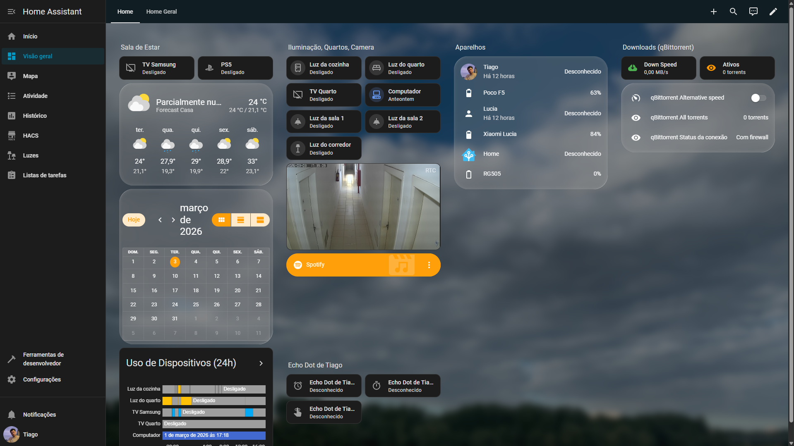
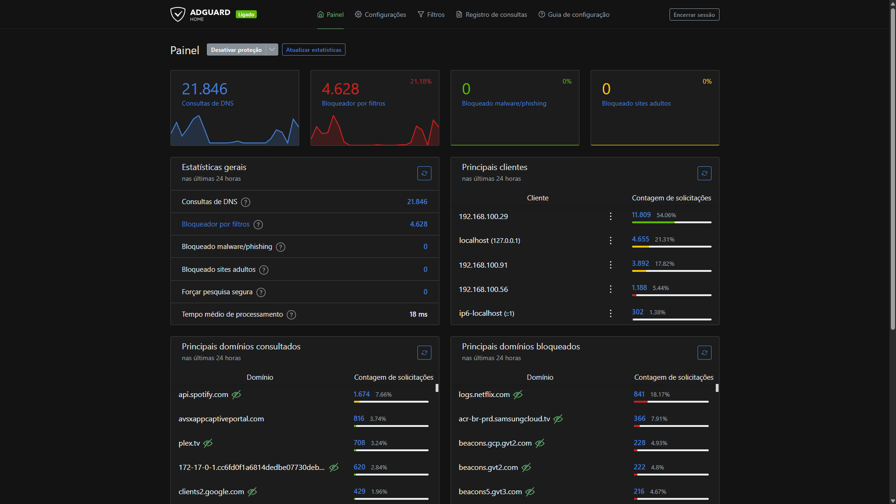
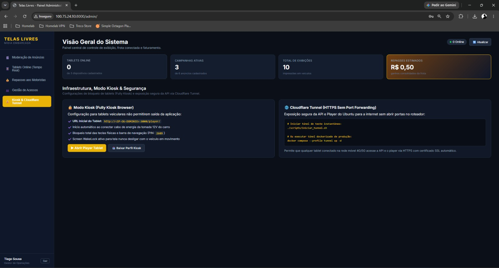
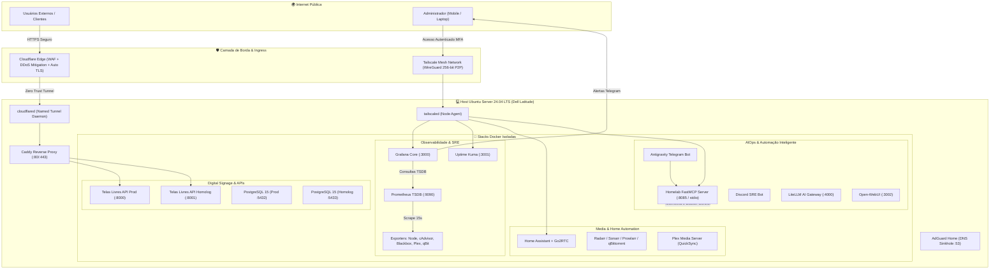

# 🚀 Homelab & AIOps Portfolio | DevOps, SRE & Autonomous Infrastructure

[](https://ubuntu.com/)
[](https://www.docker.com/)
[](https://prometheus.io/)
[](https://grafana.com/)
[](https://www.cloudflare.com/)
[](https://tailscale.com/)
[](https://modelcontextprotocol.io/)
[](https://www.python.org/)

Repositório público documentando a arquitetura física, lógica e operacional do meu **homelab pessoal em produção contínua (24/7)**. Este projeto foi desenhado para ir muito além de um ambiente doméstico tradicional: ele funciona como um laboratório corporativo de **Engenharia de Plataforma, DevOps, SRE e AIOps**, aplicando na prática conceitos de **Zero Trust, observabilidade declarativa, resiliência automatizada e governança operacional assistida por agentes autônomos de Inteligência Artificial**.

---

## 📌 Sumário Executivo

- [💡 A Filosofia do Projeto](#-a-filosofia-do-projeto)
- [🖥️ Especificações do Host & Hardware](#️-especificações-do-host--hardware)
- [📸 Galeria Visual da Infraestrutura](#-galeria-visual-da-infraestrutura)
- [🏗️ Arquitetura de Rede & Borda Zero Trust](#️-arquitetura-de-rede--borda-zero-trust)
- [🧠 AIOps: Agentes Autônomos, MCP & Ciclo de Memória](#-aiops-agentes-autônomos-mcp--ciclo-de-memória)
- [📊 Observabilidade & SRE: Telemetria Proativa](#-observabilidade--sre-telemetria-proativa)
- [🤖 ChatOps: Administração pelo Telegram e Discord](#-chatops-administração-pelo-telegram-e-discord)
- [🛡️ Resiliência Operacional & Scripts Watchdog](#️-resiliência-operacional--scripts-watchdog)
- [📂 Estrutura do Repositório](#-estrutura-do-repositório)
- [🚀 Como Reproduzir o Ambiente](#-como-reproduzir-o-ambiente)
- [👤 Sobre o Autor & Contato](#-sobre-o-autor--contato)

---

## 💡 A Filosofia do Projeto

Em ambientes de missão crítica e em operações de Provedores de Serviços Gerenciados (MSP / NOC), o maior valor de um engenheiro está na **mentalidade preventiva**: antecipar falhas antes que o cliente ou usuário final sinta lentidão ou indisponibilidade.

Este servidor foi construído com três diretrizes centrais:

1. **Zero Trust & Superfície de Ataque Mínima:** Nenhuma porta do meu roteador é exposta diretamente à internet pública (sem port forwarding, sem NAT vulnerável). O acesso externo é 100% mediado por **Cloudflare Tunnels** sob WAF e autenticação de borda, ou via **Tailscale Mesh VPN** baseada em WireGuard.
2. **Infraestrutura Imutável e Declarativa:** Todos os serviços rodam conteinerizados via **Docker Compose**, com arquivos de configuração, dashboards e regras de alerta versionados como código (GitOps).
3. **AIOps & Governança Cognitiva:** Utilizo agentes de IA locais e na nuvem integrados ao protocolo **MCP (Model Context Protocol)** e interfaces de **ChatOps** no Telegram e Discord. O agente não é um mero chatbot: ele possui ferramentas para inspecionar métricas do host, verificar containers degradados, ler alertas do Prometheus e manter uma rotina autônoma de consolidação de memória.

---

## 🖥️ Especificações do Host & Hardware

O homelab é hospedado em um notebook corporativo dedicado exclusivamente a nó de computação Linux, aproveitando o formato portátil para obter **baixíssimo consumo de energia e no-break embutido**:

| Componente | Especificação Técnica | Racional de Engenharia |
| :--- | :--- | :--- |
| **Equipamento** | Dell Latitude corporativo | Chassi compacto, silencioso (fanless em idle) e construído para ciclo de vida 24/7. |
| **Processador** | Intel® Core™ i7-1165G7 (4C / 8T @ até 4.70 GHz) | Excelente performance single-thread e transcodificação por hardware (Intel QuickSync). |
| **Memória RAM** | 16 GB DDR4 (3200 MHz) | Capacidade ideal para mais de 25 containers simultâneos sem saturação de swap. |
| **Armazenamento 1**| SSD NVMe M.2 500 GB | Baixíssima latência para o SO, PostgreSQL, séries temporais do Prometheus e volumes ativos. |
| **Armazenamento 2**| HD SATA 500 GB | Armazenamento de alta capacidade para mídias, dumps de banco e backups locais. |
| **Sistema Operacional**| Ubuntu Server 24.04.3 LTS (Kernel 6.8) | Estabilidade corporativa LTS, suporte a cgroups v2 e kernel moderno. |
| **Eficiência Energética**| **9.3W a 15W** de consumo médio | Consumo elétrico comparável a uma lâmpada LED, operando de forma sustentável e econômica. |
| **Resiliência Elétrica**| **Bateria Integrada como UPS Nativo** | Absorve micro-quedas, picos e oscilações da rede elétrica sem interrupção de containers. |

---

## 📸 Galeria Visual da Infraestrutura

### 1. Central de Serviços & Dashboard de Acesso Rápido
Interface web unificada que centraliza o status e links dos serviços internos da infraestrutura:


---

### 2. Painel Executivo do Home Assistant & Telemetria Integrada
Monitoramento em tempo real de automação residencial, retransmissão de câmeras IP via Go2RTC com baixa latência e status de downloads:



---

### 3. DNS Sinkhole Corporativo (AdGuard Home)
Mais de 21.000 requisições diárias processadas com 21% de bloqueio preventivo de telemetrias, anúncios e domínios maliciosos direto no gateway:



---

### 4. Digital Signage (Telas Livres) & Exposição de Borda
Painel administrativo do projeto comercial de mídia embarcada rodando no mesmo host, segregado em ambientes de Produção e Homologação com túneis Cloudflare:



---

## 🏗️ Arquitetura de Rede & Borda Zero Trust



*Para detalhes aprofundados sobre a arquitetura de rede, consulte a documentação dedicada em [`docs/ARCHITECTURE.md`](docs/ARCHITECTURE.md).*

---

## 🧠 AIOps: Agentes Autônomos, MCP & Ciclo de Memória

Ao contrário de abordagens convencionais de automação puramente baseadas em scripts rígidos, este homelab é administrado com **Inteligência Artificial Operacional (AIOps)** em regime contínuo.

### 1. Servidor MCP Customizado (`FastMCP`)
Desenvolvi um servidor MCP em Python ([`ai-ops/mcp-homelab-server/server.py`](ai-ops/mcp-homelab-server/server.py)) em conformidade com o padrão **Model Context Protocol** da Anthropic. Esse servidor conecta LLMs diretamente ao host Linux através de ferramentas seguras e estritamente tipadas:

* `get_host_telemetry`: Coleta CPU, memória, I/O de disco, load average e verifica se o host está rodando na bateria/UPS.
* `list_docker_containers`: Retorna estados e tempos de atividade de todos os containers.
* `restart_docker_service`: Reinicia serviços com validação rígida em allowlist predefinida.
* `get_prometheus_active_alerts`: Consulta os alertas em disparo no Prometheus.

### 2. O Agente com Memória Contínua & "Ciclo de Sono"
O agente que auxilia na administração do servidor mantém uma rotina autônoma de reflexão e consolidação de memória diária:
* **Despertar Autônomo ([`scripts/agent-memory/cerebro.sh`](scripts/agent-memory/cerebro.sh)):** Executado em horários estratégicos para sintetizar o estado atual das operações.
* **Ciclo de Sono / Consolidação ([`scripts/agent-memory/consolida_memoria.sh`](scripts/agent-memory/consolida_memoria.sh)):** Executado via crontab diariamente às **23:50**. Ele cria um backup versionado do diário acumulado (`DIARIO_BKP_*.md`), processa os acontecimentos das últimas 24 horas e reescreve a memória de forma densa e sem ruídos, preparando a cognição para o dia seguinte.

*Mais detalhes sobre a arquitetura de agentes e MCP em [`docs/AIOPS_AND_AGENTS.md`](docs/AIOPS_AND_AGENTS.md).*

---

## 📊 Observabilidade & SRE: Telemetria Proativa

A observabilidade foi projetada para cobrir todos os quatro sinais de ouro do Google SRE (**Latência, Tráfego, Erros e Saturação**):

* **Prometheus TSDB:** Intervalo de coleta (*scrape*) calibrado em **15 segundos**, com retenção histórica de 15 dias no SSD NVMe.
* **Node Exporter & cAdvisor:** Telemetria granular tanto do sistema operacional quanto de cada container individual.
* **Blackbox Exporter:** Monitoramento sintético ativo via HTTP probes e TCP checks, validando códigos de resposta 2xx, tempos de handshake e alertando quando o certificado TLS tiver menos de 7 dias para expirar.
* **Alertas Declarativos como Código:** Regras no Grafana provisionadas em YAML ([`monitoring/grafana/provisioning/alerting/alerts.yml`](monitoring/grafana/provisioning/alerting/alerts.yml)), com disparo automático de notificações ricas em HTML para o Telegram.
* **Uptime Kuma:** Monitoramento independente com status page e checagens a cada 60 segundos.

*Veja a documentação completa de telemetria em [`docs/OBSERVABILITY_SRE.md`](docs/OBSERVABILITY_SRE.md).*

---

## 🤖 ChatOps: Administração pelo Telegram e Discord

Administrar a infraestrutura a qualquer momento e a partir de qualquer dispositivo móvel foi um requisito fundamental:

### 1. Antigravity Telegram Bot ([`chatops/agy-telegram-bot/`](chatops/agy-telegram-bot/))
Interface assíncrona conectada ao **Google Antigravity CLI (`agy`)**:
* Permite enviar instruções em linguagem natural para diagnosticar o servidor, editar arquivos de configuração ou investigar logs.
* Possui lista de usuários autorizados (`ALLOWED_CHAT_IDS`), isolamento de processos com `os.setsid`, suporte a cancelamento imediato com `/cancel`, controle de diretório com `/cd` e alternância dinâmica de modelos LLM.

### 2. Homelab Discord Bot ([`chatops/homelab-discord-bot/`](chatops/homelab-discord-bot/))
Bot de sustentação operacional construído em Python com `discord.py`:
* Comandos interativos: `/status`, `/docker`, `/health`, `/temp`, `/restart <service>`, `/compose`.
* Loop de background que envia alertas com *cooldown* configurável caso CPU, RAM, disco ou temperatura atinjam limiares críticos.

### 3. Telegram Status Bot ([`chatops/telegram-status-bot/`](chatops/telegram-status-bot/))
Bot leve e direto, sem dependências pesadas, para consulta instantânea de hardware e healthcheck de rotas HTTP.

---

## 🛡️ Resiliência Operacional & Scripts Watchdog

A resiliência da infraestrutura é garantida por automações que tratam cenários reais de falha:

* **Watchdog de Montagens SSHFS & Plex ([`scripts/watchdog/plex-mount-watchdog.sh`](scripts/watchdog/plex-mount-watchdog.sh)):**
  Em caso de instabilidade de rede que cause *stale file handle* nas pastas remotas montadas via SSHFS, o script detecta o timeout com `stat`, desmonta os pontos travados de forma segura (`umount -l`), reinicia as unidades `automount` do systemd e sobe novamente o container do Plex automaticamente.
* **Reboot Preventivo Diário ([`systemd/reboot-daily.timer`](systemd/reboot-daily.timer)):**
  Disparo programado às **06:00 AM** para reciclagem de processos, limpeza de caches transitórios e garantia de que o nó sempre inicialize limpo.
* **Healthcheck do Host ([`scripts/maintenance/system-healthcheck.sh`](scripts/maintenance/system-healthcheck.sh)):**
  Script rápido de diagnóstico de hardware, rede, DNS e containers.

---

## 📂 Estrutura do Repositório

```text
homelab-aiops-portfolio/
├── assets/                          # Screenshots, diagramas e evidências visuais
│   ├── homepage.png
│   ├── homeassistant-dashboard.png
│   ├── adguard-metrics.png
│   └── telas-kiosk-cloudflare.jpeg
├── docker/                          # Manifestos Docker Compose sanitizados
│   ├── media-stack/                 # Plex, Radarr, Sonarr, Prowlarr, qBittorrent
│   ├── telas-livres/                # Digital Signage DOOH (Prod e Homolog) + Caddy + Cloudflared
│   ├── minecraft/                   # Paper Server + mc-monitor (Prometheus exporter) + Playit
│   ├── home-automation/             # Home Assistant Core + Go2RTC
│   └── ai-hub/                      # LiteLLM Multi-Model Gateway + Open-WebUI + Postgres
├── monitoring/                      # Stack completa de observabilidade
│   ├── docker-compose.yml           # Prometheus, Grafana, Node Exp, cAdvisor, Blackbox, Kuma
│   ├── prometheus/                  # prometheus.yml configurado e secrets/
│   ├── grafana/provisioning/        # Datasources, Dashboards e Alertas como código (Telegram)
│   ├── grafana/dashboards/          # JSONs de dashboards (ex: Minecraft)
│   └── scripts/                     # Automações de alertas e setup de monitores
├── chatops/                         # Bots de monitoramento e interação operacional
│   ├── agy-telegram-bot/            # Integração do Antigravity CLI com Telegram
│   ├── homelab-discord-bot/         # Bot SRE do Discord com controle de containers
│   └── telegram-status-bot/         # Bot leve de telemetria rápida
├── ai-ops/                          # Inteligência Artificial aplicada a operações
│   ├── mcp-homelab-server/          # Servidor Model Context Protocol (FastMCP)
│   └── trello-gateway/              # API Gateway para kanban e tickets
├── scripts/                         # Scripts de automação e sustentação Linux
│   ├── watchdog/                    # Watchdog de montagens SSHFS e containers
│   ├── agent-memory/                # Rotinas autônomas de despertar e consolidação de sono
│   └── maintenance/                 # Scripts de rotina e diagnósticos rápidos
├── systemd/                         # Serviços (.service) e timers (.timer) do Linux
├── docs/                            # Documentações técnicas aprofundadas
│   ├── ARCHITECTURE.md              # Decisões de rede, hardware e segurança
│   ├── AIOPS_AND_AGENTS.md          # Detalhes de agentes, MCP e fluxo cognitivo
│   └── OBSERVABILITY_SRE.md         # Métricas, PromQL e regras de alerta
└── .gitignore                       # Blindagem rigorosa de segredos, tokens e chaves
```

---

## 🚀 Como Reproduzir o Ambiente

### Pré-requisitos
* Host com **Linux (Ubuntu Server 22.04+ ou Debian 12+)**
* **Docker Engine (v26+)** e **Docker Compose Plugin**
* **Python 3.10+** (para os scripts de ChatOps e servidor MCP)
* Conta no **Cloudflare** (para túneis Zero Trust) e **Tailscale** (para VPN Mesh)

### 1. Clonar o Repositório
```bash
git clone https://github.com/souusa26/homelab-aiops-portfolio.git
cd homelab-aiops-portfolio
```

### 2. Configurar Variáveis de Ambiente
Todos os módulos contam com arquivos `.env.example`. Copie-os e preencha as variáveis correspondentes:

```bash
# Monitoramento
cp monitoring/.env.example monitoring/.env

# AI-Hub
cp docker/ai-hub/.env.example docker/ai-hub/.env

# Digital Signage
cp docker/telas-livres/.env.example docker/telas-livres/.env

# Bots ChatOps
cp chatops/agy-telegram-bot/.env.example chatops/agy-telegram-bot/.env
cp chatops/homelab-discord-bot/.env.example chatops/homelab-discord-bot/.env
```

### 3. Iniciar a Stack de Observabilidade
```bash
cd monitoring
docker compose up -d
```
Acesse o Grafana em `http://localhost:3000` (ou via IP do nó Tailscale). Os datasources e alertas no Telegram já estarão provisionados automaticamente.

### 4. Executar o Servidor MCP para o seu Agente de IA
```bash
cd ../ai-ops/mcp-homelab-server
python3 -m venv venv
source venv/bin/activate
pip install -r requirements.txt
python server.py
```

---

## 👤 Sobre o Autor & Contato

**Tiago Sousa**  
*Desenvolvedor de Software, Especialista em Infraestrutura Linux, DevOps e AIOps.*

* **GitHub:** [@souusa26](https://github.com/souusa26)
* **LinkedIn:** [linkedin.com/in/tiago-sousa](https://www.linkedin.com)
* **Email:** tiago.sousa.bezerra1234@gmail.com
* **Localização:** Brasil 🇧🇷

---

> *"Infraestrutura de alta disponibilidade não é sobre evitar que coisas quebrem, mas sobre construir sistemas inteligentes e resilientes o bastante para se recuperarem antes que qualquer pessoa perceba."*
