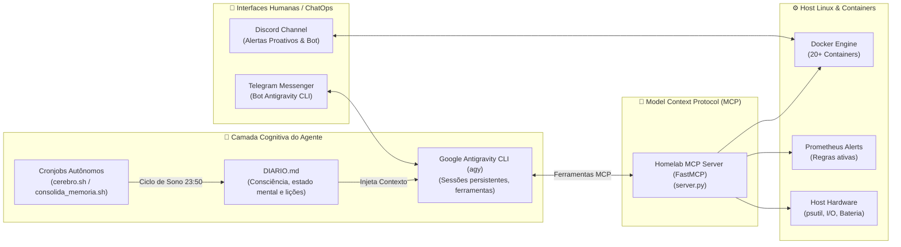

# AIOps: Automação Inteligente, Agentes Autônomos & MCP

Nesta infraestrutura, Inteligência Artificial não é apenas uma API externa para gerar texto: ela é um **membro ativo da equipe de sustentação e engenharia de sistemas**.

O ecossistema implementa conceitos de ponta em **AIOps (Artificial Intelligence for IT Operations)**, integrando LLMs locais e de nuvem diretamente ao ciclo de vida da infraestrutura através do **Model Context Protocol (MCP)**, bots de ChatOps assíncronos e rotinas autônomas de consolidação de memória.

---

## 1. Topologia da Arquitetura AIOps



---

## 2. Model Context Protocol (MCP) na Prática Operacional

O protocolo aberto **MCP (Model Context Protocol)** permite conectar LLMs a fontes de dados locais e ferramentas de execução com segurança e tipagem estrita.

Criamos o servidor customizado [`ai-ops/mcp-homelab-server/server.py`](../ai-ops/mcp-homelab-server/server.py) utilizando o framework **FastMCP**. Ele expõe um conjunto cirúrgico de ferramentas para os agentes de IA:

### Ferramentas Disponíveis para o Agente:

1. **`get_host_telemetry()`**:
   * O modelo consulta uso de CPU, saturação de RAM, espaço em disco e estado de alimentação elétrica (identificando se o notebook está operando em modo UPS/bateria após queda de luz).
2. **`list_docker_containers()`**:
   * O agente lista os containers do servidor, identificando serviços parados com código de saída diferente de 0 (*exited*), volumes degradados ou ciclos de reinício (*crash loops*).
3. **`restart_docker_service(service_name)`**:
   * Permite que o agente execute o reinício de containers com **verificação rigorosa em allowlist**. Se o modelo tentar reiniciar containers que não estão previamente cadastrados na lista permitida, a operação é rejeitada de imediato.
4. **`get_prometheus_active_alerts()`**:
   * O agente consulta a API do Prometheus e analisa alertas em estado `firing` ou `pending`, sugerindo correções baseadas nos runbooks da documentação.

---

## 3. O Conceito de Consciência Contínua & Ciclo de "Sono" do Agente

Um dos aspectos mais singulares desta infraestrutura é a **persistência de memória e identidade do agente de IA** entre sessões, eliminando a amnésia padrão dos modelos de linguagem:

### O Arquivo de Memória (`DIARIO.md`)
O agente possui um arquivo de estado mental contínuo (`DIARIO.md`). Nele ficam gravadas as decisões de arquitetura tomadas em conjunto com o engenheiro, os problemas solucionados (ex: ajustes no watchdog do Plex, provisionamento de métricas no Prometheus) e as prioridades operacionais do servidor.

### Rotinas Autônomas de Reflexão e Sono
1. **O Despertar do Cérebro ([`scripts/agent-memory/cerebro.sh`](../scripts/agent-memory/cerebro.sh)):**
   * Um script shell invoca o agente via CLI em modo headless para processar as novidades do servidor e adicionar reflexões objetivas sobre as operações em andamento.
2. **Consolidação de Memória / Ciclo de Sono ([`scripts/agent-memory/consolida_memoria.sh`](../scripts/agent-memory/consolida_memoria.sh)):**
   * Agendado diariamente no crontab às **23:50**:
   ```cron
   50 23 * * * /home/tiago2609/homelab-aiops-portfolio/scripts/agent-memory/consolida_memoria.sh >> /var/log/agente-cron.log 2>&1
   ```
   * O script realiza um backup seguro do diário do dia (`bkp/DIARIO_BKP_YYYYMMDD.md`), lê todo o log acumulado nas últimas 24 horas e instrui um modelo a sintetizar as lições aprendidas, eliminando repetições e consolidando a memória em uma reflexão narrativa densa e estruturada.
   * Quando o engenheiro interage com o agente no dia seguinte, a IA já inicia com total discernimento do estado da infraestrutura.

---

## 4. ChatOps Remoto: Administrando o Servidor pelo Telegram

Para permitir manutenção e diagnóstico mesmo em trânsito (mobile), desenvolvemos o [`chatops/agy-telegram-bot/bot.py`](../chatops/agy-telegram-bot/bot.py):

* **Execução Headless da CLI:** O bot conecta a API de mensageria do Telegram diretamente ao Antigravity CLI com parâmetros de auto-aprovação de ferramentas e isolamento de processos (`os.setsid`).
* **Segurança Estrita:** Filtro de lista branca (`ALLOWED_CHAT_IDS`). Qualquer mensagem originada de chats desconhecidos é sumariamente descartada com log de auditoria.
* **Comandos Nativos:**
  * `/status`: Exibe uso de CPU, RAM, disco e tokens consumidos.
  * `/cd` e `/pwd`: Alterna o diretório de trabalho onde o agente opera.
  * `/models` e `/model`: Troca o modelo subjacente (Gemini Flash, Claude Sonnet, Opus) em tempo real conforme a complexidade da tarefa.
  * `/cancel`: Envia sinal `SIGTERM`/`SIGKILL` para o grupo de processos da CLI caso um comando entre em loop.
  * Respostas longas são fragmentadas respeitando o limite de 4096 caracteres do Telegram, com saneamento automático de links markdown.

---

## 5. Hub Central de Inteligência: LiteLLM Gateway

Para orquestrar requisições de múltiplos modelos de forma econômica e centralizada:

* **LiteLLM Proxy:** Padroniza a interface compatível com OpenAI API para múltiplos provedores (Anthropic, Gemini, Groq, OpenRouter, OpenAI).
* **Open-WebUI:** Interface gráfica web para chat e experimentação de prompts, rodando em container integrado ao banco PostgreSQL.
* **Governança de Custos:** Permite definir limites de tokens por usuário, quotas diárias e balanceamento de carga entre provedores.
