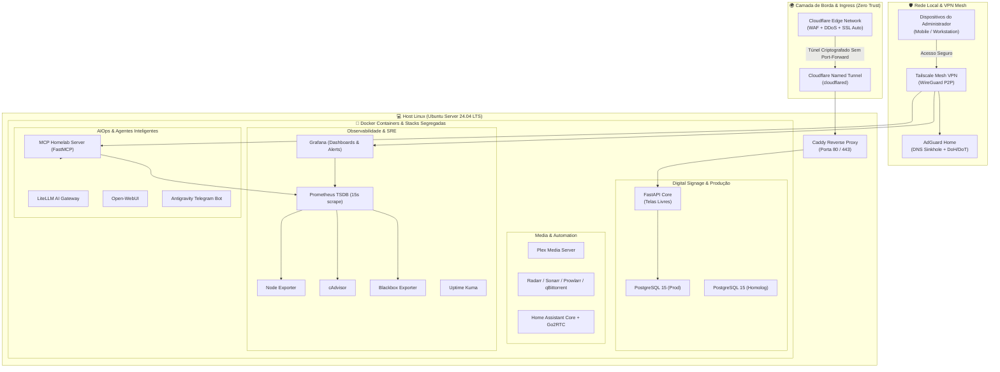

# Arquitetura Geral da Infraestrutura & Engenharia de Plataforma

Este documento detalha as decisões de engenharia, especificações de hardware, topologia de rede, segurança em camadas e orquestração do ecossistema de produção contínua (24/7).

---

## 1. Hardware do Host & Eficiência Energética

O ambiente é sustentado por um nó de computação dedicado de alta eficiência, reaproveitando hardware corporativo para maximizar estabilidade e resiliência:

* **Hardware:** Dell Latitude corporativo dedicado exclusivamente a nó de infraestrutura Linux.
* **Processador:** Intel® Core™ i7-1165G7 (4 núcleos / 8 threads, clock boost até 4.70 GHz).
* **Memória RAM:** 16 GB DDR4 (3200 MHz).
* **Armazenamento Híbrido:**
  * `SSD NVMe M.2 (500 GB)`: Sistema Operacional, bancos relacionais (PostgreSQL), séries temporais (Prometheus TSDB) e volumes ativos de containers.
  * `HD SATA (500 GB)`: Armazenamento massivo de mídias, backups locais e arquivos brutos.
* **Sistema Operacional:** Ubuntu Server 24.04.3 LTS (Kernel Linux 6.8).
* **Eficiência & UPS Nativo:**
  * Consumo médio entre **9.3W (em repouso)** e **12W a 16W (em carga de trabalho contínua)**.
  * A bateria integrada do hardware atua como um **no-break nativo (UPS)**, absorvendo micro-quedas e oscilações da rede elétrica sem reinicializações repentinas dos serviços.

---

## 2. Topologia Geral de Rede e Camadas de Isolamento

---

## 3. Pilares de Segurança & Conectividade

### Borda Zero Trust (Cloudflare Tunnels)
* **Zero Port-Forwarding:** Nenhuma porta do roteador residencial é aberta para a WAN (sem riscos de scanners automatizados como Shodan ou bots maliciosos).
* O daemon `cloudflared` estabelece túneis outbound criptografados direto para a borda da Cloudflare, aplicando WAF, políticas de geo-blocking e proteção contra ataques de negação de serviço (DDoS).

### Rede Mesh Privada (Tailscale / WireGuard)
* Acesso administrativo a painéis (Grafana, Uptime Kuma, Home Assistant, SSH) realizado exclusivamente via malha privada criptografada ponto a ponto (Tailscale).
* Autenticação multifator (MFA) e controle de acesso baseado em identidade na camada de rede.

### Higiene de Rede & Resolução DNS (AdGuard Home)
* Atua como resolvedor primário da infraestrutura interna, bloqueando telemetrias nocivas, rastreadores e domínios de malware direto no nível de DNS.
* Utiliza upstreams criptografados via **DNS-over-HTTPS (DoH)** e **DNS-over-TLS (DoT)** para garantir privacidade contra espionagem por ISPs.

### Segregação Estrita de Ambientes (Prod vs Homolog)
* O ecossistema comercial conta com ambientes de **Produção** e **Homologação** completamente independentes no mesmo nó:
  * Bancos PostgreSQL em instâncias e volumes isolados.
  * Portas internas distintas (8000 vs 8001; 5432 vs 5433).
  * Validação prévia de releases e migrações de banco (Alembic) antes da publicação em produção.
