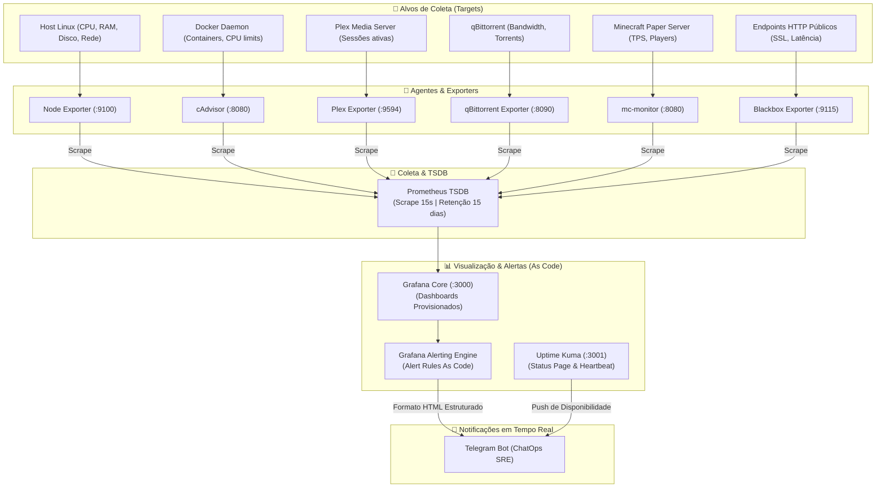

# Observabilidade, Telemetria & Práticas de SRE

A observabilidade desta infraestrutura segue os padrões de operações críticas e provedores de serviços gerenciados (MSP / NOC): **monitoramento proativo em vez de apagamento de incêndios**.

---

## 1. Arquitetura da Stack de Observabilidade

---

## 2. Métricas Coletadas & Intervalos de Scrape

| Alvo / Exporter | Porta Interna | Métricas-Chave | Resolução |
| :--- | :--- | :--- | :--- |
| **Node Exporter** | `9100` | Saturação de CPU por core, memória livre/buffers, I/O wait, IOPS de disco, throughput de rede. | 15s |
| **cAdvisor** | `8080` | Uso de CPU e limite de RAM por container, contadores de reinício, tráfego de rede isolado. | 15s |
| **Blackbox Exporter** | `9115` | Status HTTP (200-299), tempo de resolução DNS, handshake TLS/SSL, expiração de certificados. | 15s |
| **mc-monitor** | `8080` | TPS (Ticks Per Second), contagem de jogadores conectados, latência do servidor de jogos. | 15s |
| **Plex Exporter** | `9594` | Transcodificações simultâneas de hardware, largura de banda de streaming, usuários ativos. | 15s |
| **qBittorrent Exporter**| `8090` | Velocidade instantânea de download/upload, estado de seeding, saúde da fila. | 15s |

---

## 3. Provisionamento como Código (GitOps)

No diretório [`monitoring/grafana/provisioning/`](../monitoring/grafana/provisioning/), toda a configuração do Grafana é versionada e declarativa:

* **Datasources ([`datasources/datasource.yml`](../monitoring/grafana/provisioning/datasources/datasource.yml)):**
  Conexão nativa com o Prometheus via proxy interno, sem necessidade de configuração manual via interface.
* **Dashboards ([`dashboards/dashboards.yml`](../monitoring/grafana/provisioning/dashboards/dashboards.yml)):**
  Provedor automático que carrega dashboards JSON (como o painel completo do Minecraft e métricas de containers) direto do disco.
* **Contact Points ([`alerting/contactpoints.yml`](../monitoring/grafana/provisioning/alerting/contactpoints.yml)):**
  Integração direta com o bot do Telegram utilizando injeção de variáveis de ambiente.
* **Notification Templates ([`alerting/templates.yml`](../monitoring/grafana/provisioning/alerting/templates.yml)):**
  Templates customizados em Go Template gerando mensagens elegantes com emojis, severidade (`critical`, `warning`) e anotações explicativas.
* **Alert Rules ([`alerting/alerts.yml`](../monitoring/grafana/provisioning/alerting/alerts.yml)):**
  Regras de alerta com pipeline moderno de 3 estágios do Grafana (A: PromQL -> B: Reduce -> C: Math Condition):
  * **Queda de Endpoint HTTP:** Alerta crítico se o serviço sair do ar por mais de 2 minutos.
  * **Latência Elevada de Aplicação:** Alerta de aviso se o tempo de resposta exceder 5 segundos por 3 minutos consecutivos.
  * **Expiração de Certificado SSL:** Alerta preventivo se o certificado TLS do domínio tiver menos de 7 dias de validade.
  * **Esgotamento de Memória em Container:** Alerta se qualquer container ultrapassar 90% do seu limite de memória.
